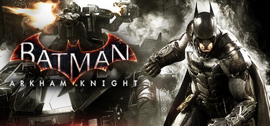

**Batman: Arkham Knight is the epic conclusion to the Arkham series, featuring Gotham City as a massive open world, the Batmobile as both combat and racing vehicle, and a dark story about Batman facing his greatest challenge. The most content-rich Arkham game.**

---

## 📖 About

Batman: Arkham Knight is the epic conclusion to the Arkham series, featuring Gotham City as a massive open world, the Batmobile as both combat and racing vehicle, and a dark story about Batman facing his greatest challenge. The most content-rich Arkham game.

## ⚠️ Problems Without Trainer

| Problem | Status |
|---------|--------|
| **Batmobile Overuse** — Tank combat feels repetitive and disconnected from core gameplay | ✅ Solved |
| **Riddler Trophies** — 243 trophies required to unlock true ending creates enormous grind | ✅ Solved |
| **PC Port Issues** — Originally launched in terrible PC state; performance issues persist | ✅ Solved |
| **Militia Tank Encounters** — Mandatory drone tank battles frustrate non-combat players | ✅ Solved |

## ✅ Solution

The **Batman: Arkham Knight Trainer** solves all these issues by giving you complete control over the game.

## 🎯 Full Feature List

- Unlimited Resources
- God Mode / Invincibility
- Instant Skill Cooldown
- One-Hit Kill
- Freeze Game Timer
- Unlock All Items & Achievements
- Custom Speed Multiplier
- Save State Anywhere

## 🚀 Quick Start

1. **Disable Windows Defender** temporarily (trainer may trigger false positive)
2. Download the trainer from the button above
3. Launch Batman: Arkham Knight
4. Run the trainer as Administrator
5. Activate desired cheats with hotkeys

## 💎 Free vs Paid

| Feature | Free | Pro |
|---------|------|-----|
| Basic God Mode | ✅ | ✅ |
| Unlimited Resources | ✅ | ✅ |
| All Advanced Cheats | ❌ | ✅ |
| Auto-Updates | ❌ | ✅ |
| Priority Support | ❌ | ✅ |

## 💻 Requirements

- Windows 10/11 (64-bit)
- Batman: Arkham Knight (any version)
- .NET Framework 4.8+
- DirectX 11+

## 🍎 macOS

macOS users can use our alternative tool:

## ⚖️ Legal

This trainer is for educational and single-player use only. Use responsibly.

---

